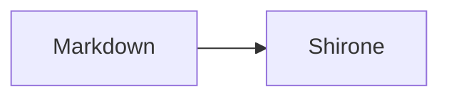

## Standard Markdown

Paragraph **strong** *emphasis* ~~removed~~ and `inline code`.

- First item
- Second item

| Feature | State |
| --- | --- |
| GFM | Enabled |

Footnote reference[^note].

[^note]: Upstream footnote body.

## Enhanced syntax

> [!NOTE]
> Upstream alert body.

:::details[Native disclosure]
Full readable body.
:::


Inline $x^2 + y^2$.

$$
E = mc^2
$$

```ts title="example.ts" {1}
const answer = 42;
console.log(answer);
```



[[Literal wiki]] %%literal comment%%

[Visit home](/)
